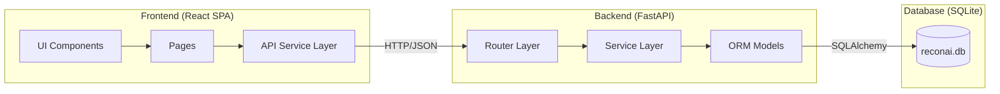
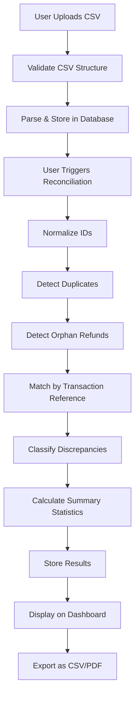
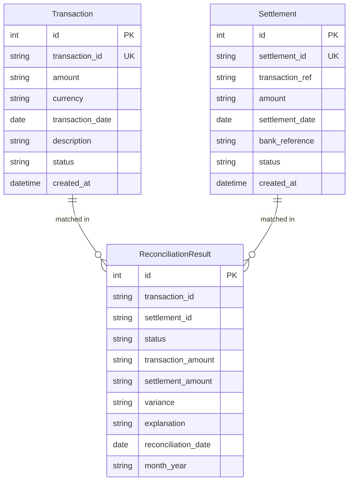

# Architecture

This document describes the architecture of ReconAI, covering the system's layered design, component structure, data flow, database schema, and API design principles.

---

## System Overview

ReconAI uses a **three-tier architecture** separating presentation, business logic, and data persistence:



| Tier       | Technology              | Responsibility                                      |
|------------|------------------------|------------------------------------------------------|
| Frontend   | React + Vite + Tailwind | User interface, form handling, data visualisation    |
| Backend    | Python + FastAPI        | API endpoints, reconciliation logic, report generation |
| Database   | SQLite + SQLAlchemy     | Persistent storage of transactions, settlements, results |

---

## Backend Structure

### Application Entry Point

`backend/app/main.py` — Creates the FastAPI application, registers CORS middleware, includes all routers, and creates database tables on startup.

### Directory Layout

```
backend/
├── app/
│   ├── __init__.py
│   ├── main.py                  # FastAPI app, CORS, startup
│   ├── database.py              # Engine, SessionLocal, Base
│   ├── models/
│   │   ├── __init__.py
│   │   └── models.py            # Transaction, Settlement, ReconciliationResult
│   ├── schemas/
│   │   ├── __init__.py
│   │   └── schemas.py           # Pydantic request/response models
│   ├── routers/
│   │   ├── __init__.py
│   │   ├── transactions.py      # /api/transactions/*
│   │   ├── settlements.py       # /api/settlements/*
│   │   ├── reconciliation.py    # /api/reconciliation/*
│   │   ├── reports.py           # /api/reports/*
│   │   └── sample_data.py       # /api/sample-data/*
│   ├── services/
│   │   ├── __init__.py
│   │   ├── reconciliation_engine.py  # Core matching algorithm
│   │   ├── discrepancy_detector.py   # Exception classification
│   │   ├── sample_data_generator.py  # Realistic test data creation
│   │   └── report_generator.py       # CSV/PDF export
│   └── utils/
│       ├── __init__.py
│       ├── money.py             # Decimal parsing, rounding, comparison
│       └── validators.py        # CSV validation, date parsing
├── tests/
│   ├── __init__.py
│   └── test_reconciliation.py   # 18 test cases
├── requirements.txt
└── Procfile
```

### SQLAlchemy ORM (Database Layer)

`database.py` configures the SQLite engine with `check_same_thread=False` for FastAPI's async compatibility. The `SessionLocal` factory produces sessions injected into route handlers via FastAPI's `Depends(get_db)`.

### Models

Three SQLAlchemy models map to database tables:

- **Transaction** — Stores uploaded payment company records
- **Settlement** — Stores uploaded bank settlement records
- **ReconciliationResult** — Stores the output of each reconciliation run

Monetary amounts are stored as **strings** (not floats) and parsed to `Decimal` at the service layer.

### Service Layer

The service layer contains the core business logic, isolated from HTTP concerns:

| Service                    | Responsibility                                                        |
|---------------------------|-----------------------------------------------------------------------|
| `ReconciliationEngine`    | Orchestrates the full reconciliation workflow: normalise → detect duplicates → detect orphan refunds → match → classify → summarise |
| `DiscrepancyDetector`     | Classifies matched/unmatched records into discrepancy types           |
| `SampleDataGenerator`     | Creates realistic transaction and settlement data with built-in discrepancies for testing |
| `ReportGenerator`         | Exports reconciliation results as CSV or PDF (via ReportLab)          |

### Router Layer

Each router handles a logical group of API endpoints:

| Router              | Prefix                   | Responsibility            |
|---------------------|--------------------------|---------------------------|
| `transactions.py`   | `/api/transactions`      | CRUD and CSV upload       |
| `settlements.py`    | `/api/settlements`       | CRUD and CSV upload       |
| `reconciliation.py` | `/api/reconciliation`    | Run engine, get results   |
| `reports.py`        | `/api/reports`           | Export and summary        |
| `sample_data.py`    | `/api/sample-data`       | Generate/clear test data  |

### Utilities

| Module          | Purpose                                                       |
|-----------------|---------------------------------------------------------------|
| `money.py`      | `parse_money()` — parses strings/floats to `Decimal`; `round_money()` — banker's rounding; `is_within_tolerance()` — rounding-tolerance comparison |
| `validators.py` | Validates CSV structure, required columns, date formats       |

---

## Frontend Structure

### Technology

- **React 18** — Component-based UI with hooks for state management
- **Vite** — Fast dev server with HMR and optimised production builds
- **Tailwind CSS** — Utility-first styling
- **React Router** — Client-side routing

### Component Hierarchy

```
App.jsx
├── Layout
│   ├── Navbar              # Navigation links
│   └── Sidebar             # Quick stats
├── Pages
│   ├── Dashboard           # Summary cards, charts
│   ├── Upload              # File upload with drag-and-drop
│   ├── Reconciliation      # Run engine, view results table
│   └── Reports             # Monthly summaries, export buttons
└── Components
    ├── FileUpload           # Drag-and-drop CSV upload widget
    ├── DataTable            # Sortable, filterable data table
    ├── SummaryCard          # Metric display card
    ├── StatusBadge          # Colour-coded status indicator
    └── Charts               # Reconciliation visualisations
```

### State Management

State is managed using **React hooks** (`useState`, `useEffect`, `useCallback`). No external state library is used — the application's data flow is straightforward:

1. User action triggers an API call via the service layer
2. Response updates local component state
3. UI re-renders with new data

### API Service Layer

`src/services/api.js` provides a centralised HTTP client (using `fetch` or `axios`) configured with the `VITE_API_URL` base URL. Each service function maps to a backend endpoint, handling request formatting and response parsing.

---

## Data Flow



1. **Upload** — User uploads transaction and settlement CSV files via the Upload page
2. **Validate** — Backend validates CSV structure, required columns, and data types
3. **Store** — Valid records are persisted to the SQLite database
4. **Reconcile** — User triggers the reconciliation engine, which processes all records
5. **Display** — Results appear on the Reconciliation page with filterable tables and summary cards
6. **Export** — User exports results as CSV or PDF from the Reports page

---

## Database Schema



### Key Design Decisions

- **Amounts as strings** — Monetary values are stored as strings to avoid SQLite float precision issues. The service layer converts to `Decimal` for all arithmetic.
- **Separate results table** — Reconciliation results are stored independently of source data, preserving immutability of uploaded records.
- **Month-year indexing** — The `month_year` field on `ReconciliationResult` enables efficient monthly report queries.

---

## API Design Principles

1. **RESTful conventions** — Resources are nouns (`/transactions`, `/settlements`), actions use HTTP verbs (GET, POST, DELETE)
2. **Consistent response format** — All endpoints return JSON with predictable structure
3. **Input validation** — Pydantic schemas validate all incoming data before it reaches the service layer
4. **Error handling** — HTTP status codes convey outcomes (200 success, 400 bad request, 404 not found, 500 server error)
5. **CORS enabled** — Cross-origin requests are allowed for frontend-backend communication during development and deployment
6. **Stateless** — Each request is self-contained; no server-side session state
